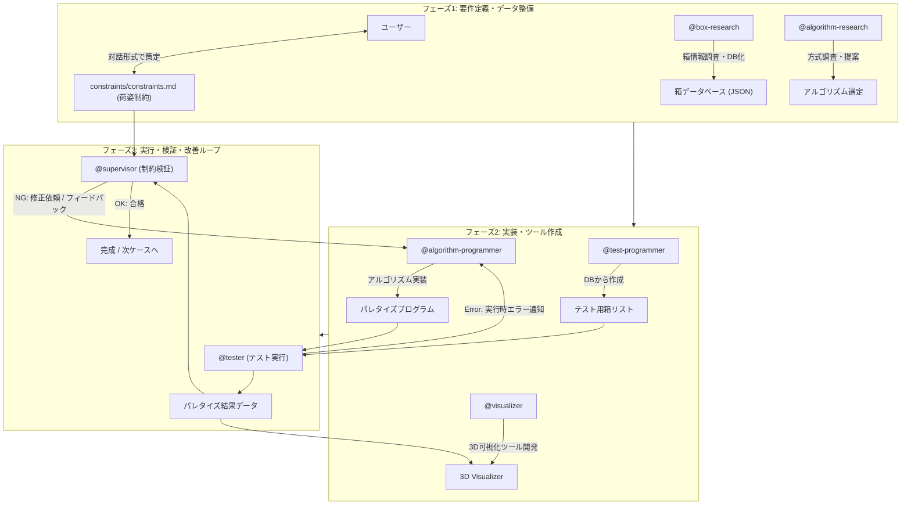

# パレタイズアルゴリズム試作 (GitHub Copilot 版)

<!-- markdownlint-configure-file
{ "MD013": { "tables": false, "code_blocks": false } }
-->

> **プロジェクト移行**: Antigravity 2.0 → GitHub Copilot
>
> このプロジェクトは、GitHub Copilot を活用したループエンジニアリングで箱パレタイズ（嵌合・リブ付き空箱のパレタイズ）アルゴリズムおよび評価基盤を開発する。

---

## 1. GitHub Copilot エージェント構成と役割

以下の8ロールでループエンジニアリングを実行します。
各ロールのサブエージェント定義は `.github/agents/` ディレクトリに
`*.agent.md` として格納されており、
GitHub Copilot CLI から `/agent <name>` または `@<name>` で直接呼び出せます。

- **`orchestrator`** (`.github/agents/orchestrator.agent.md`)
  - 全体進行管理。ユーザーからの要望に応じて計画を立案し、作業指示を行い、プロジェクト全体の進行と整合性を管理する。

- **`box-research`** (`.github/agents/box-research.agent.md`)
  - パレタイズ対象となる箱（通い箱・オリコン等）の寸法・嵌合深さ・リブ仕様などを調査し、データベース化する。

- **`algorithm-research`** (`.github/agents/algorithm-research.agent.md`)
  - 嵌合やリブ構造を考慮した箱パレタイズアルゴリズムに関して情報を検索・調査し、本プロジェクトに適した方式を提案する。

- **`test-programmer`** (`.github/agents/test-programmer.agent.md`)
  - `box-research` がデータベース化した箱情報をもとに、テスト・評価用の箱リスト（単載・混載等の投入パターン）を作成する。

- **`algorithm-programmer`** (`.github/agents/algorithm-programmer.agent.md`)
  - `algorithm-research` が提案した方式に基づきパレタイズアルゴリズムを実装する。
  - `supervisor` や `tester` からのフィードバックをもとにプログラムの改良を行う。

- **`visualizer`** (`.github/agents/visualizer.agent.md`)
  - アルゴリズムが出力したパレタイズ結果（配置座標、回転、積み順）を3D/2Dで描画・可視化するツールを開発・提供する。

- **`tester`** (`.github/agents/tester.agent.md`)
  - `test-programmer` が作成した箱リストを入力として `algorithm-programmer` のプログラムを実行し、荷山形成シミュレーションを行う。
  - エラーや例外発生時はエラー内容をプログラマにフィードバックする。

- **`supervisor`** (`.github/agents/supervisor.agent.md`)
  - `constraints/constraints.md`（荷姿制約）に基づき、出力された荷姿や積み順が制約を満たしているかを監視・検証する。
  - 制約違反がある場合は、具体的な問題点とともにプログラムの修正を依頼する。

### 1.1 役割定義ファイルの3系統について

本リポジトリには目的の異なる3種類のロール定義ファイル群があり、混同しないよう役割を整理する。

| ディレクトリ | 位置づけ | 読み込まれ方 |
| --- | --- | --- |
| **`.github/agents/*.agent.md`** | **サブエージェント定義（正）**。各ロールの詳細な行動指針を保持する | GitHub Copilot CLI から `/agent <name>` や `@<name>` で明示的に呼び出す |
| `.github/instructions/*.instructions.md` | 各ロールの要約版。常時参照させたい要点のみを保持する | GitHub Copilot CLI/VS Code に**常時自動読込**される（呼び出し不要） |
| `.github/prompts/*.prompt.md` | VS Code Copilot Chat 用スラッシュコマンド（`.github/agents/` と同内容＋`argument-hint`） | VS Code で `/<name>` を入力して呼び出す（VS Code利用時の代替手段） |

ロールの行動指針を変更・追加する場合は **`.github/agents/*.agent.md` を正として更新**し、
必要に応じて `.github/prompts/*.prompt.md`（VS Code用）と
`.github/instructions/*.instructions.md`（常時読込の要約）にも反映する。

---

## 2. 共通データ仕様

### 品番DB移行・第5段階（独立検証・結果表示）

- [Supervisor](supervisor/catalog_validation.py) が品番結果を正式に読み込みます。
  品番・モデル・固定蓋・仕入先・数量・パレット条件を現在のDBとケースで照合してから、
  共通モデルによる段積み・干渉・支持等を再検証します。保存済みのPASS表示だけでは合格にしません。
- [統合3D画面](visualizer/index.html)と[単独HTML生成](visualizer/visualize.py)は
  品番・箱名称・仕入先・共通モデル・固定蓋・品番別数量に対応しました。旧結果も表示できます。
  表示は計算時点の記録であり、現在のDBで勝手に書き換えません。
- 150件を再計算・正式検証し、**148件PASS／2件FAIL、実行エラー0件**。
  投入3132箱・配置2588箱・未配置544箱、全件で品番数量と計算／検証の判定が一致しました。
  FAILの `aisin_10_m20` / `othics_m20` は以前と同じ配置0箱です。
- 今回の[結果](tester/catalog_results/phase5_verified/)と
  [独立検証レポート](supervisor/catalog_reports/phase5_verified/validation_report.md)を別保存しました
  （生成物はGit管理外）。既存DB・旧ケース・旧結果・旧レポートは上書きしていません。

```powershell
# 次回の実行では、結果・レポートとも未使用のフォルダ名に変更してください
python .\tester\run_tests.py --catalog --output-dir .\tester\catalog_results\my_run
python .\supervisor\validate.py --catalog-results .\tester\catalog_results\my_run --report-dir .\supervisor\catalog_reports\my_run
python .\visualizer\serve_3d_viewer.py --results-dir .\tester\catalog_results\my_run
```

DB・品番ケースを編集した場合は再計算してください。古い結果は表示できますが、
現在のDBと照合値が異なる結果は検証を止め、再計算を案内します。
従来コマンドの既定動作は旧方式のままです。品番方式は上記のように明示指定します。
詳細は[検証ガイド](supervisor/README.md#品番方式の独立検証第5段階)と
[表示ガイド](visualizer/README.md#品番方式の結果表示第5段階)を参照してください。

### 品番DB移行・第4段階（品番方式の計算）

- [品番方式の計算処理](algorithm_programmer/catalog.py)を追加しました。
  共通モデルと蓋が同じ品番はまとめて単載計算し、確定した積み順に入力順で品番を配分します。
  品番・仕入先・現場の箱名称・モデル名・蓋、品番別の投入／配置／未配置数を結果に残します。
- 既存の嵌合・支持・箱蓋外形・TP箱の異モデル段積みの安全条件は変更していません。
  返却数量の割合をそろえる処理は未実装です。
- `python .\algorithm_programmer\cli.py --catalog-case othics_6 -o .\tester\catalog_results\othics_6.json`
  で明示的に新方式を選択します。一括実行は
  `python .\tester\run_tests.py --catalog --output-dir .\tester\catalog_results\review_phase4`
  です。出力先は未使用のフォルダを指定します。
- 150ケースを別出力で実行し、投入3132箱・配置2588箱・未配置544箱、実行エラー0件。
  制約判定は148件PASS・2件FAILで、品番別数量は150件とも一致しました。
  FAILの `aisin_10_m20` / `othics_m20` は旧方式でも配置0箱・FAILです。
  全150件で旧方式より配置数が減っていないこと、およびテスト用に品番をDB上のモデルへ解決して
  既存Supervisorで独立検証した判定が全件一致することも確認しました。
- 旧DB・ケース・採用状態・結果、従来コマンドの参照先は維持します。
  新結果をSupervisorや3D表示へ渡す対応は第5段階で実装済みです。既定動作は旧方式を維持しています。
  [計算・結果項目の説明](algorithm_programmer/README.md#品番方式の計算第4段階)を参照してください。

### 品番DB移行・第3段階（編集画面対応）

- [新DB編集画面](box_research/catalog_viewer.html)で品番・箱モデル・蓋を編集し、
  モデル名変更時には関連品番・蓋・ケースを確認します。パレットタブは参照表示で、
  既存のパレット編集機能は従来画面で維持します。
- 同じ画面の品番ケース編集では仕入先→品番→数量で選び、箱と蓋を自動表示します。
  [準備用ケース](box_research/catalog/test_cases.json)に150ケース・200箱行を別保存しました。
- 既存DB・CSV原本・ケース・採用状態・計算結果は変更していません。
  第4段階のCLI・計算への接続は、ユーザーの合意を受けて上記のとおり実装しました。
- 両既存サーバーから新画面へのリンクを利用できます。
  操作手順は[第3段階ガイド](box_research/README.md#db品番ケース編集画面第3段階計算への切替前)を参照してください。

### 品番DB移行・第2段階（新DB登録・既存処理へ未接続）

- [新DB](box_research/catalog/)へ362品番・81箱モデル・24種類の蓋と移行対応表を登録しました。
- [保存処理](box_research/catalog_store.py)と[共通検証](box_research/database_validation.py)で、
  参照整合性・文字統一・重複・寸法を確認し、モデル名の変更前確認と関連参照の一括更新を行います。
- 既存画面・CLI・Supervisorを壊さないため、新DBは切替前の専用フォルダに分離しています。
  第2段階では旧DB・ケース・計算結果は変更しておらず、画面変更・計算への反映も行っていません。
- 第3段階はユーザーの合意を受けて上記のとおり実装しました。
  操作と制限は[第2段階のガイド](box_research/README.md#品番モデルdbの登録と検証第2段階既存処理へ未接続)を参照してください。

### 品番DB移行・第1段階（事前確認のみ）

- [移行確認ツール](box_research/preview_migration.py)で、CSV・現DB・全ケースから、
  品番／箱モデル／固定蓋の対応案と、ケースに割り当てる品番の確認資料を生成します。
- DB・CSV原本・ケース・採用状態・計算結果は変更せず、計算処理やビューアへの反映も行いません。
- 出力をユーザーと確認し、第2段階の実装に合意するまで適用しません。
  実行手順と各資料の読み方は[箱DBの事前確認ガイド](box_research/README.md#品番db移行の事前確認第1段階未適用)を参照してください。

### ビューア起動修正・保存前チェックの共通化（2026-11-06）

- テストケースビューアはWindowsで `py .\test_programmer\serve_testcase_viewer.py` による
  直接起動に対応します。モジュール起動や環境変数設定は不要です。
- DB形式・互換蓋・パレット仕様の検証を
  [共通処理](box_research/database_validation.py)に分離しました。
  テストケース保存時は画面に加えてサーバーでも箱・蓋の存在、互換性、数量などを確認します。
- DB・ケースの保存形式と実データは変更しません。
  詳細・検証コマンドは[テストケース利用ガイド](test_programmer/README.md)を参照してください。
- パレットDB保存時も本体寸法はDBを正とし、ケース内の寸法コピーとの比較は行いません。
  全既存ケースがある状態で、DBを変更せず保存できることも回帰テストで確認します。

### 上載せ平パレット支持安定性（2026-11-05）

- 下側と同寸法・同XY位置の上載せパレットを、最高接触面から3 mm以内の露出上面で支持します。
  原則外周4隅、TP331/TP-331は中央を含む5点支持です。箱DBの `top_support_points` で4/5を指定できます。
  内部空間だけではNGにしません。四隅が欠ける場合だけ、最上面の接触支持外周の前/奥と左/右に
  各670 mm以上の連続支持を要求します。短辺側を含む4辺すべてが必要です。
  四隅が埋まっていても、1箱が複数隅を支える場合は接触支持領域全体の外接短辺670 mm以上が必要です。
  均等荷重の重心（パレット中心）が接触支持面の凸包内部にあることは常に必要です。
  凸包面積は設定上限面積（`max_x_span × max_y_span`）の65%以上、
  面積重心のパレット中心からのずれは各方向で設定幅の1/4未満とします（境界はNG）。
  凸包には内部空間を含めます。実際の荷山外形面積・実接触面積を基準にはしません。
- 配置候補選定・上面支持調整・最終サマリー・Supervisorへ反映しました。
  `summary.top_support` に支持点・高さ・連続辺長・例外理由等を記録します。
  詳細は[制約仕様](constraints/constraints.md#5-上載せ平パレットの支持安定性2026-11-05改訂)と
  [実装ドキュメント](algorithm_programmer/README.md)を参照してください。実耐荷重・たわみは保証しません。
- 下段は同一配置、最上段だけ安定した端数配置を許可しました。
  配置数 → 四隅支持 → 低高さ → 端数段なし → 外形占有率 → X長手 → 中央接触の順で選び、
  短い箱列・箱行を中央寄せし、四隅＋中央の定形5点配置も候補に加えます。
  混載上段には下段四隅の直上候補も別枠で追加し、既存候補を維持します。
  aisin_5専用の未配置ルールは追加していません。othics_9の最大Xのみ1135 mmへ訂正しました。
- 採用済み30ケースの再計算・検証は全件PASS、実行エラー0件。
  投入625箱・配置531箱・未配置94箱、はみ出し要確認21ケース。
  aisin_7は6＋6＋5箱、othics_9は6箱×5段＋最上段4箱、othics_4は四隅＋中央の5箱、
  nittan_2はX長手の9箱全配置となりました。aisinの4＋4＋3箱は対向両側670 mmを満たさず9箱配置を維持します。
  四隅優先により、一部は中央寄せ分割案より風車等を選びます。個別詳細は実装ドキュメントを参照してください。
  aisin_4は19/21/22/24箱目の直上へ配置、arresuthi_2は3＋3＋3箱・2箱未配置、
  arresuthiは3箱×2段、nok_2は4箱×7段・3箱未配置、othics_3は6箱×2段・3箱未配置となりました。
  端数段なし優先でaisin_3は6＋6箱を維持します。ケース別段数・専用余り・高さ/支持幅比は設けません。
  関連テストは133件中130件合格、既存失敗2件（HEADでも再現）、スキップ1件です。
  詳細は[検証レポート](supervisor/reports/validation_report.md)を参照してください。

### 単載の風車配置・外形占有率（2026-11-04）

- 格子状・分割配置に加えて、中央を空けた4箱の風車（ロの字）を最大1候補追加しました。
  制約を満たす案を、総配置数 → 低い荷姿高さ → 高い外形占有率の順に比較します。
  外形占有率は「箱・蓋の外接矩形面積 ÷（ケースの最大L × 最大W）」です。中央空間も含み、安全性を示す指標ではありません。
- aisin_10は4箱1段、aisin_9は4箱2段、nittan系は4箱2段の風車配置になりました。
  nittan_2は引き続き1箱未配置です。ケースの投入数量・蓋・パレット条件は変更していません。
- 採用済み30ケースを再実行・独立検証し、全件PASS、実行エラー0件。
  投入625箱・配置519箱・未配置106箱、はみ出し要確認16ケースです。
  nittan系は手前・奥に各53.5 mmのはみ出しがあり、取り扱い上の確認が必要です。
- 直接関連するPythonテスト55件合格。Supervisorテストの既存失敗2件とスキップ1件は継続しています。
  混載の出力不変・計算時間の比較・詳細結果は[実装ドキュメント](algorithm_programmer/README.md#2026-11-04単載の風車候補外形占有率)と
  [独立検証レポート](supervisor/reports/validation_report.md)を参照してください。

### パレットDB参照の整合性確認（2026-11-05）

- テストケースJSONのパレット本体L/W/Hを削除し、`pallet_id` からパレットDBを参照する形式に統一しました。
  荷姿上限3項目はケース固有値として保持します。結果JSONには検証用の寸法を記録します。
- 採用済み30ケースを再実行し、投入625箱のうち531箱を配置、94箱が未配置でした。
  全30ケースがアルゴリズム判定と独立検証にPASSし、はみ出し要確認は21ケースです。
- 関連Pythonテスト164件中161件合格、Supervisorの既知のテスト失敗2件とスキップ1件は継続しています。
  失敗は外嵌め蓋のテスト用Z座標に関する既存項目で、今回の変更範囲外です。

### ケース別パレット・荷山最大外形設定（2026-11-03）

ケース編集画面で仕入先とパレット型番を選択し、荷山最大L/W/Hを設定できます。
パレット本体L/W/Hは選択した型番のDB値を使用し、画面で個別入力はしません。
型番不明時は標準パレット（1200 × 1000 × 130 mm）を選択します。
荷山上限の既定値は1360 × 1100 × 1200 mmです。
荷山最大Hはパレット上面からの荷物部分のみで、本体Hを含みません。上限と等しい寸法も許可します。
固定800 mm下限、はみ出し許容値と670 mm例外は廃止しました。
左右・手前・奥のはみ出しは「要確認」として表示し、合否とは分離します。
パレット直置きでも本体底面の実支持率85%以上が必要です。実物の安定性を保証するものではありません。
ケースJSONでは本体L/W/Hを `pallet_id` から参照し、荷姿上限3項目のみを保持します。
実行結果には検証の再現性のため、実行時点のパレット寸法を記録します。旧結果は再計算してください。
詳しくは[制約仕様](constraints/constraints.md)と[ケース編集方法](test_programmer/README.md)を参照してください。

### 仕入先別パレットDB（2026-11-05）

[パレットDB](box_research/pallet_db.json)を追加し、箱・蓋と同じ統合ビューアの「パレットDB」タブで編集できます。
同一型番・同一寸法は共通仕様として扱い、複数仕入先が使用する場合は同じ仕様に仕入先名を紐付けます。
同一型番でも寸法が異なる場合は別仕様です。ケース作成時は仕入先を選択してから型番を選びます。
ケースJSONは `pallet_id` を保存し、L/W/Hは実行時にパレットDBから取得します。
荷姿上限などケース固有の値のみ `pallet` に保存します。
該当型番がない場合は編集不可の「標準パレット（型番未指定）」1200×1000×130 mmを選択できます。
個別寸法入力はありません。既存30ケースには仕入先を登録し、
実型番22件・標準パレット8件を設定しました。寸法など既存条件は変更していません。

検証結果（2026-11-03）:

- 今回の機能に関係するPythonテスト68件が合格。編集画面のJavaScript検証と、
  統合・スタンドアロン両ビューアのガイド・高さ・4視点の収まりなど15件も合格。
- 採用済み30ケースを再計算し、今回更新された結果だけを独立検証して30件PASS、実行エラー0件。
  投入625箱のうち配置512箱、未配置113箱。はみ出し要確認は18ケース。
  制約PASSは全箱配置を意味しません。詳細は[検証レポート](supervisor/reports/validation_report.md)を参照してください。
- 関連Python全体では76件中73件合格、既存不具合による失敗2件、スキップ1件。
  失敗は外嵌め蓋のテスト用Z座標が支持高さと一致しない既存2件で、変更前でも再現します。
  スキップは削除済みケースを参照する混載テストで、旧ケースは復活させていません。

### 箱DBの統合（2026-10-28）

提供された箱DBから43件の互換蓋を追加し、SP3315をTP規格に変更しました。
混載計算への影響を避けるため、高さは全件で既存値を維持しています。
この統合時点の登録箱数は94件でした。現在は不要な箱データを整理し、登録箱数は81件です。
当時の変更内容は[箱DB統合記録](box_research/README.md#箱db統合記録2026-10-28)を参照してください。

### 蓋DBの統合（2026-10-27）

提供データを [蓋DB](box_research/lid_db.json) に統合し、11件から25件に更新しました。
現在の登録件数は24件です。不要な蓋データを1件削除しています。
同一寸法でも別製品のIDは保持しています。既存8件の高さ増加量変更と表記・分類修正の詳細は
[蓋DB統合記録](box_research/README.md#蓋db統合記録2026-10-27) を参照してください。

### 下段隅の被覆条件（2026-10-27追加）

各上段箱の本体底面が覆う、直接支持箱群の隅について、同じXY位置を除いて2か所以上を要求します。
各下段箱ごとの2隅・隣接条件は要求しません。蓋付きも対象とし、パレット直置きは免除します。
外嵌め蓋付きTP箱と非TP箱は、それぞれの既存コラム積み条件を満たす場合に限って免除します。
下段は箱・蓋外形、上段は本体底面を使い、XY許容差は各方向0.01 mmです。
支持率85%以上などの既存制約を維持し、候補選択・最終結果・独立バリデータで確認します。
詳細は[制約仕様3.(4)](constraints/constraints.md)と[実装ドキュメント](algorithm_programmer/README.md)を参照してください。
実物の嵌合・安定性の保証ではありません。旧結果は新条件に違反する場合があるため再計算・再検証が必要です。

### 単載の配置方針（2026-11-05更新）

同一箱型番・同一蓋の単載は、上載せ支持を含む全制約を満たす候補の中から、
**配置数 → 四隅支持 → 低高さ → 端数段なし → 外形占有率 → X長手 → 中央接触**の順に選びます。
1層の個数を減らした分割配置も比較し、完全な下段では同じX/Y位置・回転角度を繰り返します。
最上段のみ、下段パターンの部分集合による安定した端数配置を許可します。
例：aisin_3は6個×2段、aisin_7は6＋6＋5個を配置します。
探索対象は生成したグリッド・分割・風車・定形5点配置であり、任意の配置に対する大域最適性は保証しません。
段ごとの配置反転は行いません。少数投入にも凸包面積・偏り・複数隅支持時の短辺条件を適用し、
支持条件を満たせない残箱は未配置として返します。
混載は別方式で探索し、既存候補に下段四隅の直上候補を追加しています。
詳細と検証結果は[実装ドキュメント](algorithm_programmer/README.md)を参照してください。

※空箱を前提とするため重量パラメータは扱いません。

寸法を人向けに表示・記載する順序は **L × W × H（長手方向 × 短手方向 × 高さ）** に統一します。
箱・蓋DBでは `length` が長手方向L、`width` が短手方向Wです。
パレタイズ結果の `width` / `length` は回転後のX/Y方向寸法なので、
表示時は長い辺をL、短い辺をWとして扱います。既存キーや保存値の入れ替えは行いません。

### (1) 箱データベース仕様 (`box_db`)

- `id` (string): 箱の識別子 / 型番
- `length` (float): 外寸長手方向 L [mm]
- `width` (float): 外寸短手方向 W [mm]
- `height` (float): 外寸高さ [mm]
- `fitting_depth` (float): 上下に積み重ねたときの勘合（はまり込み）深さ [mm]
- `rib_thickness` (float): 上面から見た箱の上縁幅 [mm]。底面や側壁の肉厚ではなく、外側の縁から開口部側の縁までの幅。テーパー等があるため外寸・内寸からは自動計算しない。
- `compatible_lids` (array): 箱に対応する実蓋IDリスト（例: `["LID-001", "LID-002"]`）。無蓋は全箱共通の選択肢として扱い、この配列には含めない。

[箱・蓋DB統合ビューア](box_research/db_viewer.html) は
`python box_research/serve_viewer.py` で起動し、
`http://localhost:8081/` で利用します。起動時の選択入力は不要です。
箱DBは採用・不採用を管理せず、登録箱すべてを保存・JSON出力します。
検索・規格別フィルターは表示専用で、保存・出力対象には影響しません。
不要な箱は削除してから保存します。
箱の仕様列・検索・規格別集計・編集操作と蓋DBの機能を維持し、
タブで切り替えても未保存の編集を保持します。
保存は明示操作で行い、蓋のID変更・削除等で両DBを保存する必要がある場合は保存範囲を確認します。
テストケースで使用中の箱は削除・ID変更を禁止し、保存時にもサーバーで参照を再検査します。
テストケース側の採用・不採用（実行対象の選別）は従来どおりです。

2026-10-29: 外部作成のテストケース30件を元の個別設定のまま採用状態で追加しました。
追加時点では既存27件と合わせて57件が一括テストの対象でした。現在の登録件数は30件です。
登録内容は[テストケース仕様書](test_programmer/README.md)を参照してください。
採用登録は配置結果の制約検証PASSを意味しません。
既存の箱・蓋ビューアURLは統合画面の該当タブへ転送します。
説明図は全点を見直すため現在は表示せず、図案と配置の確認後に追加します。
詳細は [読み込み・保存の説明](box_research/README.md#箱dbビューアの読み込み保存) を参照してください。

### (1.5) 蓋データベース仕様 (`lid_db`) **[NEW: Phase 2]**

- `id` (string): 蓋の識別子 / 蓋ID
- `name` (string): 蓋の名称（例: 「クリア蓋 TP-330系用」）
- `type` (string): 蓋の規格タイプ（例: `"TP"`, `"NONE"`, `"OTHER"`）
- `width` (float): 蓋の短手方向 W [mm]
- `length` (float): 蓋の長手方向 L [mm]
- `thickness` (float): 蓋装着時の高さ増加量 [mm]（蓋ありの箱の高さ − 蓋なしの箱の高さ）。蓋単体の全高や天板の肉厚ではない。
- `fit_type` (string): 蓋の嵌め方
  - `"外嵌め"`: 箱外側面と蓋で位置決め（最も一般的）
  - `"内嵌め"`: 箱内壁面と蓋で位置決め
  - `"なし"`: 蓋を使用しない場合
- `description` (string): 対応規格や特徴の説明
- `color` (string, 任意): 色名（例: `"黒"`, `"青"`, `"透明"`）。未設定は `""`、旧データの項目省略も可。蓋DB画面で編集・保存する仕様情報であり、配置計算・制約検証・3D描画には使用しない。

**蓋DBの用途**:

- 箱データ（`box_db`）の `compatible_lids` フィールドで箱と蓋の互換性を管理
- テストケース生成時に蓋選択肢を提供
- テストケース作成・編集画面の蓋選択肢に `fit_type`（外嵌め・内嵌め・なし）を表示。保存値は従来の `lid_id` を維持。
- テストパターン一覧の投入箱内訳に、蓋の有無と嵌め方を文字で表示。蓋情報を確認できない場合は「蓋情報不明」と表示。
- パレタイズ結果に蓋情報を付加（将来拡張）

### (2) パレット仕様 (`pallet_spec`)

- `length` (float): パレットX方向寸法 [mm]（標準パレットの長辺 L）
- `width` (float): パレットY方向寸法 [mm]（標準パレットの短辺 W）
- `height` (float): パレット本体高さ [mm]（初期値130）
- `max_height` (float): 最大積載高さ（パレット上面からの高さ） [mm]
- `max_x_span` / `max_y_span` (float): 荷山最大L/W [mm]（初期値1360/1100）
- 全6項目は0より大きい有限値。最大外形L/W/Hは設定値以下とし、固定下限は設けません。
  荷山最大Lは最大W以上とします。本体L/Wの逆指定は読み込み時に長辺/短辺へ揃えます。
- 旧 `min_x_span` / `min_y_span` / `max_overhang_x_mm` / `max_overhang_y_mm` /
  `max_small_edge_overhang_mm` は無視し、ケース画面で保存すると削除します。
- 結果JSONの `input_box_variants` に、未配置も含めた投入箱ID・蓋IDの種類を保存する。
- 結果の `summary.overhang_mm` に左右・手前・奥、`warnings` に確認情報、
  `total_height` にパレット込み総高さを記録します。

パレットの寸法は `length` = X方向の長辺L、`width` = Y方向の短辺Wとします。テストケース、結果JSON、表示もこの意味に統一します。

配置結果の箱・蓋外形を囲む外接矩形は、各方向でパレット中心に合わせます（中心誤差0.01 mm以内）。

### (3) パレタイズ結果データ仕様 (`palletize_result`)

配置される各箱のリスト：

- `order` (int): 積み込み順番（1, 2, 3, ...）
- `box_id` (string): 配置対象の箱ID
- `position`: `coordinate_reference` に従う配置座標 [mm]
- `coordinate_reference`: `combined_footprint_min_xy_top_z` の場合、XYは箱・蓋外接形状の最小X・最小Y角、Zは蓋込み上面。フィールドなしの既存結果は従来の箱本体底面角。
- `dimensions.width/length`: 回転後の箱本体のX/Y寸法。
  `dimensions.height` は蓋厚込み。蓋寸法は `lid_dimensions` に別記。
- `rotation`: 箱の回転向き `r` (例: 0度, 90度)

---

## 3. 荷姿制約 (`constraints/constraints.md`) の作成方針

- 荷姿制約はプロジェクトルートに `constraints/constraints.md` として独立して管理する。
- 嵌合ルール、リブ干渉、はみ出し許容、段積みパターンの制約などは、**ユーザーと対話形式でヒアリングしながら決定・作成**する。

---

## 4. GitHub Copilot ループエンジニアリング実行フロー



### 実行手順

1. **フェーズ1: 要件定義・データ整備**
   - ユーザーとの対話により `constraints/constraints.md`（荷姿制約）を作成・確定。
   - `@box-research` を呼び出し、箱仕様（嵌合深さ・リブ厚み含む）を調査・DB化。
   - `@algorithm-research` を呼び出し、嵌合箱に対応可能なパレタイズ手法を調査・提案。

2. **フェーズ2: 実装・ツール作成**
   - `@test-programmer` を呼び出し、テストケース（箱投入リスト）を作成。
   - `@algorithm-programmer` を呼び出し、パレタイズエンジンを実装。
   - `@visualizer` を呼び出し、荷姿と積み順を3D/2Dで直感的に確認できる可視化ツールを作成。

3. **フェーズ3: 実行・検証・改善ループ** (自律反復)
   - `@tester` を呼び出し、テスト箱リストでアルゴリズムを実行し、結果データを生成。
   - `@visualizer` で荷姿を可視化。
   - `@supervisor` を呼び出し、`constraints/constraints.md` をもとに制約違反がないかを厳格にチェック。
   - NGまたは実行時エラーの場合は `@algorithm-programmer` に改善フィードバックを返し、合格するまでループ。

---

## 5. GitHub Copilot 利用方法

### サブエージェント呼び出し（GitHub Copilot CLI・推奨）

`.github/agents/*.agent.md` に定義されたサブエージェントは、CLI から以下のいずれかの方法で直接呼び出せます：

1. **`/agent` コマンドで選択**

   ```text
   /agent orchestrator
   ```

2. **`@<name>` によるメンション呼び出し**

   ```text
   @orchestrator [タスク説明]
   ```

### ロール別プロンプト呼び出し（VS Code Copilot Chat）

VS Code の Copilot Chat で作業する場合は、`.github/prompts/*.prompt.md` をスラッシュコマンドとして利用できます：

1. **スラッシュコマンド呼び出し** (推奨)

   ```text
   /orchestrator [タスク説明]
   ```

2. **ファイル参照による呼び出し**

   ```text
   @codebase
   .github/prompts/orchestrator.prompt.md の指示に基づいて [タスク] を実行してください。
   ```

3. **直接的な指示**

   ```text
   orchestrator として以下を実行してください：
   [タスク説明]
   ```

### グローバル指示書の参照

- `.github/copilot-instructions.md`: GitHub Copilot 全体のグローバル指示書
  - コーディング規約、ビルド/テストコマンド、制約仕様、キー概念解説を含む
  - 常時参照可能なリファレンス
- `.github/instructions/*.instructions.md`: 各ロールの要約版行動指針
  - GitHub Copilot CLI・VS Code に**常時自動読込**され、呼び出し不要で常に参照される

---

## 6. ディレクトリ・アーティファクト構成

各ロール担当者（GitHub Copilot）が生成・管理する成果物（アーティファクト、コード、データ）は、以下のディレクトリに分離して管理する。

```text
palletizing_prototype/feature/
├── README.md                  # 【このファイル】プロジェクト構成・GitHub Copilot 実行ガイド
├── .github/
│   ├── copilot-instructions.md # GitHub Copilot グローバル指示書（v2.0）
│   ├── agents/                # 【正】GitHub Copilot CLI サブエージェント定義（/agent, @<name> で呼び出し）
│   │   ├── orchestrator.agent.md
│   │   ├── box-research.agent.md
│   │   ├── algorithm-research.agent.md
│   │   ├── test-programmer.agent.md
│   │   ├── algorithm-programmer.agent.md
│   │   ├── visualizer.agent.md
│   │   ├── tester.agent.md
│   │   ├── supervisor.agent.md
│   │   └── README.md
│   ├── instructions/           # 各ロールの要約版行動指針（常時自動読込）
│   │   ├── orchestrator.instructions.md
│   │   ├── box-research.instructions.md
│   │   ├── algorithm-research.instructions.md
│   │   ├── test-programmer.instructions.md
│   │   ├── algorithm-programmer.instructions.md
│   │   ├── visualizer.instructions.md
│   │   ├── tester.instructions.md
│   │   └── supervisor.instructions.md
│   └── prompts/                # VS Code Copilot Chat 用ロール別スラッシュコマンド（代替手段）
│       ├── orchestrator.prompt.md
│       ├── box-research.prompt.md
│       ├── algorithm-research.prompt.md
│       ├── test-programmer.prompt.md
│       ├── algorithm-programmer.prompt.md
│       ├── visualizer.prompt.md
│       ├── tester.prompt.md
│       ├── supervisor.prompt.md
│       └── README.md
├── constraints/               # 荷姿制約仕様書
│   └── constraints.md
├── box_research/              # 【box-research】箱仕様調査レポート、box_db.json
├── algorithm_research/        # 【algorithm-research】アルゴリズム調査・方式提案書
├── test_programmer/           # 【test-programmer】テストデータ生成スクリプト、テスト箱リスト
├── algorithm_programmer/      # 【algorithm-programmer】パレタイズアルゴリズム実装モジュール
├── visualizer/                # 【visualizer】3D/2D可視化ツール、描画ビューワ
├── tester/                    # 【tester】テスト実行スクリプト、シミュレーション結果データ、ログ
├── supervisor/                # 【supervisor】制約バリデーションスクリプト、検証レポート
└── scripts/                   # 各種実行スクリプト（run_loop_cycle.sh 等）
```

---

## 7. 重要：Git コミット制約

**GitHub Copilot で作業中は、以下を厳守してください：**

- ❌ **Git commit / push を実行しない**
- ❌ **Git add を実行しない**
- ❌ **ブランチ操作を行わない**

✅ **ローカルワーキングツリーのみで作業し、成果物を保持してください。**

詳細は `.github/copilot-instructions.md` を参照。

---

## 8. 参考情報

- **`constraints/constraints.md`**: 荷姿制約の詳細仕様
- **`.github/copilot-instructions.md`**: GitHub Copilot 用グローバル指示書（コーディング規約、ビルド/テストコマンド含む）
- **`.github/agents/README.md`**: GitHub Copilot CLI サブエージェントの一覧・使用ガイド（正）
- **`.github/instructions/`**: 各ロールの要約版行動指針（常時自動読込）
- **`.github/prompts/README.md`**: VS Code用ロール別プロンプトの使用ガイド（代替手段）

---

## 9. 混載探索の改善（2026-10-14）

- 奥行きを単一の箱寸法の整数倍に固定せず、異なる奥行きの行を組み合わせて探索する。積載制約は変更しない。
- 途中の並べ方を最大16通り残し、最下段候補も最大16通り上段まで試して、四隅調整後の合否と最終箱数で選ぶ。
- `outer_cover_test` は16箱・短辺寸法不足から48箱・合格に改善。全27ケースをメモリ上で検証し、配置数減少なし、合計1062箱から1258箱。
- 計算時間の合計は約0.15秒から約3.4秒へ増加（環境依存）。探索数を限定しており、最適配置の保証はない。
- 回帰テスト: `python -m unittest supervisor.validate_test -v`（15テスト合格）。
  詳細は [アルゴリズム説明](algorithm_programmer/README.md) を参照。
- 保存結果は今回の `outer_cover_test` を更新。全件の結果ファイルと既存の検証レポートは、このメモリ上の検証では更新していない。

---

**バージョン**: 2.1 (GitHub Copilot 版・`.github/agents` サブエージェント対応)  
**最終更新**: 2026-10-14
**プロジェクト状態**: ✅ 全テストケース合格 (27/27 PASS、メモリ上の再検証)
